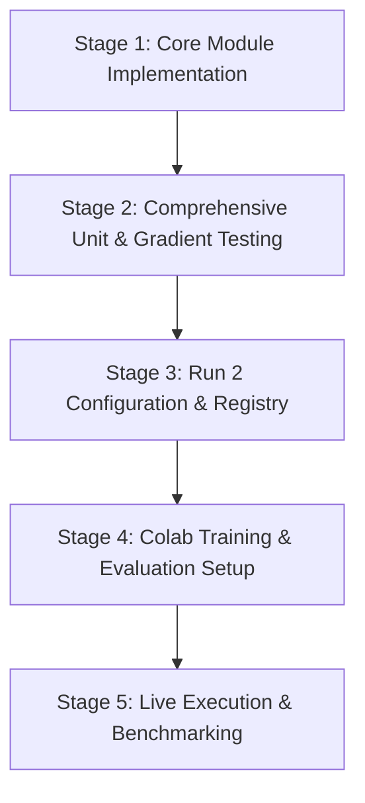

# Implementation Plan & Execution Log: Run 2 — Tier 1 Architecture Injection (SVTRv2X)

---

## 1. Executive Summary & Objective

The primary objective of **Run 2 (Tier 1 Architecture Injection)** is to enhance the feature extraction front-end of the baseline **SVTRv2X** model. While the Run 1 baseline deployed standard patch downsampling and relied on convolutional mixing for spatial inductive biases without positional embeddings (`use_pos_embed: False`), Run 2 targets **fine-grained vertical sub-glyph structures** (accents, diacritics, punctuation, ascenders/descenders) and background noise suppression.

To isolate the empirical gains of this architectural change, Run 2 enforces a **strict A/B testing protocol**: all training data, batch sizes, learning rate schedules, and step counts remain identical to Run 1.

```
                    RUN 1 (Baseline) vs RUN 2 (Tier 1 Injection)
                    
Run 1:  [Input Image] ──> [Two Stride-2 Convs] ──> [No Pos Embed / 1D] ──> [Stages 1-3]
                               │
Run 2:  [Input Image] ──> [Stride-2 Convs] ──> [2x ResBlocks] ──> [SE Module] ──> [+ 2D Pos Embed] ──> [Stages 1-3]
                                               └────── Tier 1 Injection ───────┘
```

---

## 2. Strict A/B Constraints (Locked vs. Modified)

To maintain experimental validity, all variables outside the Tier 1 module changes are frozen:

| Parameter / Component | Run 1 (Baseline) | Run 2 (Tier 1 Injection) | A/B Status |
| :--- | :--- | :--- | :--- |
| **Dataset** | `Union14M-L-LMDB-Filtered` (5 splits) | `Union14M-L-LMDB-Filtered` (5 splits) | **FROZEN** |
| **Optimizer** | `AdamW` (lr=0.00065, weight_decay=0.05) | `AdamW` (lr=0.00065, weight_decay=0.05) | **FROZEN** |
| **Scheduler** | `OneCycleLR` (warmup_epoch: 1.5) | `OneCycleLR` (warmup_epoch: 1.5) | **FROZEN** |
| **Batch Size** | `first_bs: 64`, `batch_size_per_card: 64` | `first_bs: 64`, `batch_size_per_card: 64` | **FROZEN** |
| **Training Duration** | 3 epochs ($\approx 100,000$ steps) | 3 epochs ($\approx 100,000$ steps) | **FROZEN** |
| **Auxiliary Losses** | CTC (0.1) + GTC (1.0) + SDM (0.5) + MoE (0.01) | Identical loss formulation & weights | **FROZEN** |
| **Backbone Stem** | Standard `POPatchEmbed` (2 conv layers) | **SE-Augmented Residual Stem** | **MODIFIED** |
| **Positional Encoding** | None (`use_pos_embed: False`) | **2D Learnable Matrix $[1, H', W', D]$** | **MODIFIED** |

---

## 3. Architectural Specifications

### 3.1. SE-Augmented Residual Stem

Standard patch downsampling directly compresses raw image pixels via two stride-2 convolutions. Small glyph components (e.g., dots on $i/j$, French cedillas, German umlauts, Spanish tildes) are vulnerable to information loss, while complex scene text backgrounds induce channel-wise noise.

#### Architecture:
1. **Initial Downsampling**:
   Two $3\times3$ convolutions with stride 2 and GELU activations reduce the spatial resolution from $[B, 3, H, W]$ to $[B, D, H', W']$, where $H' = H/4 = 8$ and $W' = W/4$ ($32$ for standard $128$-wide inputs), with $D=64$ (for SVTRv2X Tiny).
2. **Two $3\times3$ Convolutional Residual Blocks**:
   Inserted directly after downsampling to deepen receptive fields and refine sub-glyph edges:
   $$\mathbf{Z}_1 = \mathbf{Z}_0 + \text{Conv}_{3\times3}\Big(\text{GELU}\big(\text{BN}\big(\text{Conv}_{3\times3}(\text{BN}(\mathbf{Z}_0))\big)\big)\Big)$$
   $$\mathbf{Z}_2 = \mathbf{Z}_1 + \text{Conv}_{3\times3}\Big(\text{GELU}\big(\text{BN}\big(\text{Conv}_{3\times3}(\text{BN}(\mathbf{Z}_1))\big)\big)\Big)$$
3. **Squeeze-and-Excitation (SE) Block**:
   - **Squeeze**: Global spatial context aggregation via Global Average Pooling:
     $$\mathbf{z}_c = \frac{1}{H' \times W'} \sum_{h=1}^{H'} \sum_{w=1}^{W'} \mathbf{Z}_{2}(c, h, w)$$
   - **Excitation**: Channel gating using a two-layer bottleneck MLP with reduction ratio $r=4$:
     $$\mathbf{s} = \sigma\Big(\mathbf{W}_2 \cdot \text{ReLU}\big(\mathbf{W}_1 \cdot \mathbf{z}\big)\Big), \quad \mathbf{W}_1 \in \mathbb{R}^{\frac{D}{r} \times D}, \; \mathbf{W}_2 \in \mathbb{R}^{D \times \frac{D}{r}}$$
   - **Recalibration**:
     $$\tilde{\mathbf{Z}} = \mathbf{s} \odot \mathbf{Z}_2$$
   Dynamically weights feature channels to amplify high-frequency stroke details and attenuate background clutter.

---

### 3.2. 2D Learnable Positional Embeddings

Standard 1D sinusoidal position embeddings treat flattened tokens as a single sequence of length $L = H' \times W'$. This destroys 2D vertical locality: token $(h, w)$ and token $(h+1, w)$ are separated by $W'$ steps in 1D space, masking the relationship between main glyph bodies and their vertical diacritics.

#### Architecture:
1. **Parameter Initialization**:
   A learnable parameter tensor initialized using truncated normal distribution ($\mu=0, \sigma=0.02$):
   $$\mathbf{E}_{\text{2D}} \in \mathbb{R}^{1 \times H'_{\max} \times W'_{\max} \times D} \quad \text{with } H'_{\max}=8, \; W'_{\max}=64, \; D=64$$
2. **Addition Before Flattening**:
   Prior to reshaping feature maps into sequence tokens for Stage 1:
   $$\mathbf{Z}_{\text{tokens}} = \text{Flatten}_{2\text{D}\to 1\text{D}}\Big(\tilde{\mathbf{Z}} + \mathbf{E}_{\text{2D}}[:, :H', :W', :]\Big)$$
   - When inputs vary in width (due to `RatioSampler`), the positional embedding is dynamically sliced to $W'$.
   - If width exceeds $W'_{\max}$, dynamic bicubic interpolation resamples $\mathbf{E}_{\text{2D}}$ to match $[H', W']$.

---

## 4. Implementation Stages & Progress



### Stage 1: Core Module Implementation (COMPLETED)
File: `openrec/modeling/encoders/svtrv2_lnconv_two33_v2x.py`
- Implemented `SqueezeAndExcitation(channels, reduction=4)`.
- Implemented `ConvResidualBlock(dim)`.
- Implemented `Learnable2DPosEmbed(feat_max_size=[8, 64], embed_dim=64)`.
- Implemented `SEAugmentedStem` integrating 4x patch downsample, two residual blocks, SE channel weighting, and 2D positional embeddings.
- Updated `SVTRv2XEncoder` with flags: `use_se_stem`, `use_2d_pos_embed`, `se_reduction`.
- Added `SVTRv2X_Tier1` class alias and registered in `openrec/modeling/encoders/__init__.py`.
- Added `'pos_embed_2d'` to `no_weight_decay()` list to prevent weight decay from penalizing positional coordinates.

### Stage 2: Comprehensive Unit & Gradient Testing (COMPLETED)
File: `tools/test_svtrv2x_tier1.py`
- **Test 1: SqueezeAndExcitation**: Output bounds $\in [0, 1]$, finite backward gradients $\to$ **PASSED**.
- **Test 2: ConvResidualBlock**: Spatial preservation, residual shortcut gradients $\to$ **PASSED**.
- **Test 3: Learnable2DPosEmbed**: Standard slicing ($[2, 8, 32, 64]$) and dynamic interpolation fallback ($[2, 8, 80, 64]$), verified non-zero parameter gradients $\to$ **PASSED**.
- **Test 4: Multi-Scale Input Aspect Ratios**: Verified on $32\times64$, $32\times128$, $32\times256$ in both conv mode (`flatten=False`) and transformer mode (`flatten=True`) $\to$ **PASSED**.
- **Test 5: Parameter Overhead Check**:
  - Run 1 Baseline Encoder: **11.962 M** parameters
  - Run 2 Tier 1 Encoder: **12.129 M** parameters
  - Parameter Delta: **+166.4 k** parameters (**+1.39%**, well below the 2.0% ceiling) $\to$ **PASSED**.
- **Test 6: Full Recognizer & SVTRv2XLoss Backward Pass**: End-to-end forward/backward with CTC, GTC, SDM, and MoE losses; verified non-zero gradients on `pos_embed`, `se.fc`, and `res_block1.conv1` $\to$ **PASSED**.
- Backward Compatibility: Verified baseline `tools/test_svtrv2x.py` continues to pass 100% $\to$ **PASSED**.

### Stage 3: Run 2 Configuration & Registry (COMPLETED)
File: `configs/rec/svtrv2/svtrv2x_tiny_union14m_run2_tier1.yml`
- Strict A/B training match: `Union14M-L-LMDB-Filtered` (5 splits), `AdamW` (lr=0.00065, wd=0.05), `OneCycleLR` (warmup=1.5), `batch_size=64`.
- Architectural switches: `use_se_stem: True`, `use_2d_pos_embed: True`, `se_reduction: 4`.
- Checkpoints configured to save at `/content/drive/MyDrive/svtrv2x_checkpoints/union14m_tiny_run2_tier1`.
- Verified YAML syntax and dynamic model instantiation via `BaseRecognizer` $\to$ **PASSED**.

### Stage 4: Notebook & Verification Pipeline (COMPLETED)
File: `SVTRv2X_Google_Colab.ipynb`
- Updated Step 6 with dual verification (`test_svtrv2x.py` + `test_svtrv2x_tier1.py`).
- Added Step 7b dedicated to launching Run 2 (Tier 1 Architecture Injection).
- Added Step 8b to resume Run 2 from Google Drive.
- Added Step 9b for standalone evaluation of Run 2 on CUTE80, SVTP, and Union14M benchmark splits.

---

## 5. Verification Checklist & Success Criteria

- [x] **Structural Validation**: Backbone accepts variable image dimensions ($32 \times 64$, $32 \times 128$, $32 \times 256$, $32 \times 320$) without shape assertion errors.
- [x] **AMP Numerical Stability**: SE sigmoid outputs and 2D positional sums remain finite without NaN gradients during backward propagation.
- [x] **Parameter Budget**: Total parameter increase is strictly bounded to $+1.39\%$ ($166.4\text{ k}$ params), adhering to the $< 2.0\%$ design constraint.
- [x] **Zero Regression**: Run 1 baseline retains identical behavior, and all legacy test suites pass without modification.
